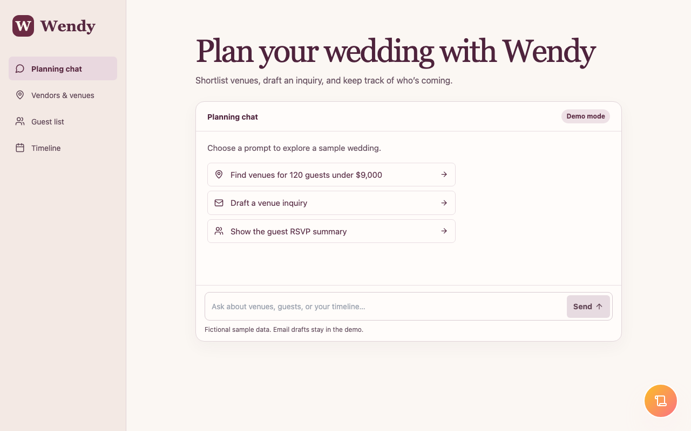

# Wendy

Wendy is a wedding-planning assistant that helps you shortlist venues, draft inquiries, track guest RSVPs, and organize a timeline. The demo runs locally with fictional data and needs no API keys.



## Try the demo

Use Node.js 22 or later.

```sh
git clone https://github.com/Thaarak/wendy-showcase.git
cd wendy-showcase
npm ci
npm run dev
```

Open [localhost:3000](http://localhost:3000). Try **Find venues for 120 guests under $9,000**, then ask **Draft an inquiry for Cedar Hall**. Wendy uses the earlier guest count in the draft. In **Guest list**, add a guest or change an RSVP and ask for a summary in chat.

Demo chats, guests, vendor notes, and timeline entries are saved in this browser. The demo uses built-in responses and previews messages without sending email or making a booking. [See an example inquiry](docs/venue-inquiry.png).

## What I built

In the original team project, I built the venue-search tool, connected it to the chat flow, and implemented the reservation-request workflow that collects event details and drafts an inquiry. For this showcase, I added a key-free version of those flows, fixed the install and build, and made the planning workspace usable on phones.

The web app uses Next.js, React, and TypeScript. The optional local integrations use a FastAPI service with SQLite.

## Optional live integrations

Use the live services locally for a single wedding workspace. Start them only on loopback and use new credentials for accounts you control.

1. Copy `.env.example` to `.env.local`. Set `WENDY_ENABLE_LIVE=true` and add an OpenAI key for chat and drafting. An Anthropic key is needed for live venue search.
2. Install the Python dependencies with Python 3.11 or later and start the service from the repository root:

   ```sh
   python3 -m venv .venv
   . .venv/bin/activate
   python -m pip install -r mcp-server/requirements.txt
   set -a
   . ./.env.local
   set +a
   python mcp-server/wendy_mcp_server.py
   ```

3. Run `npm run dev` in a second terminal. Live guest records are stored in the Python service’s local SQLite database.

To test outbound mail, set `WENDY_ALLOW_EMAIL=true` and configure `WENDY_SMTP_USER` and `WENDY_SMTP_PASSWORD` for Gmail SMTP. Then enable **Allow a real email for the next message** in the chat before submitting a fully specified invitation or venue inquiry. A venue inquiry requests availability. The venue must confirm any booking.

Run `npm run typecheck` and `npm run build` to verify the web app.

## Original team

Thaarak Sriram, [ShrishPremkrishna](https://github.com/ShrishPremkrishna), [AryamanGandhi](https://github.com/AryamanGandhi), and Kenny.
